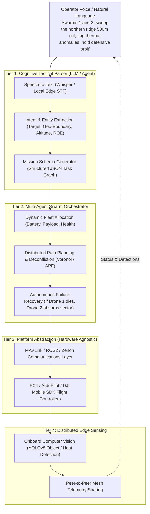
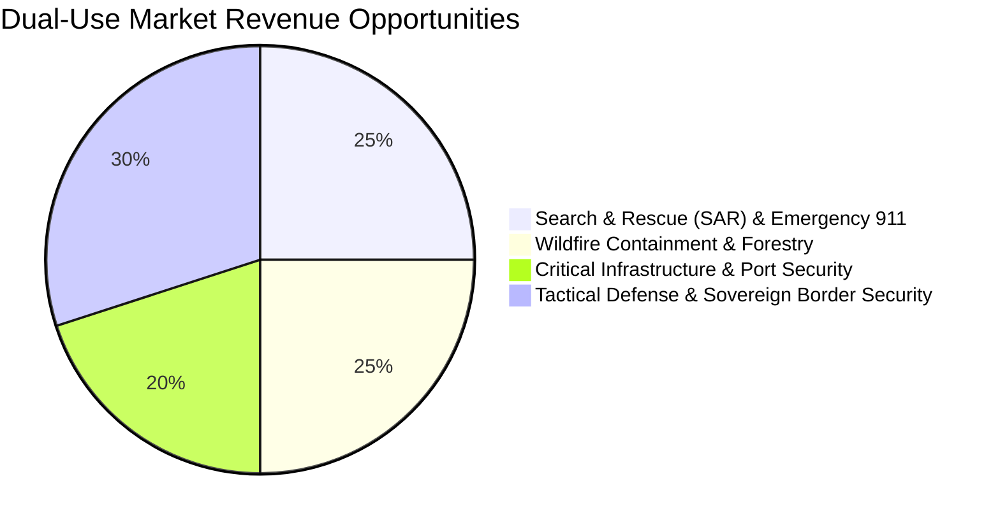

# Natural Language Drone Swarm C2: Frontier Architecture Blueprint

> *"The future of autonomous systems is not one human piloting one robot. It is one human expressing intent to an autonomous swarm of fifty robots."*  
> — **The 1:N Operator Paradigm (Degla, Swarmer, Shield AI)**

---

## 1. The Core Crisis: The "Pilot Bottleneck"

Militaries, police forces, search-and-rescue teams, and commercial infrastructure operators can easily buy **50 or 500 drones** ($500 to $2,000 each). 

However, they face an insurmountable human bottleneck:
* **The 1:1 (or 2:1) Limitation**: Today, every single drone in the air requires a dedicated, trained human pilot glued to a screen with joysticks, plus a second human often operating the camera/payload.
* **Cognitive Overload Under Adrenaline**: In high-stakes situations—wildfires, hostage search-and-rescue, battlefield ambushes—operating complex ground stations (QGroundControl, Mission Planner, DJI FlightHub) and clicking individual waypoints on 2D maps leads to catastrophic human error.
* **The Holy Grail**: Moving from **1 Human : 1 Robot** to **1 Human : 50 Drones**, where the human acts as the **strategic commander**, and the software acts as the **autonomous swarm orchestrator**.

---

## 2. Why Degla Inc. & Swarmer Are So Hot

| Company | Batch / Origin | What They Built | Market Impact |
| :--- | :--- | :--- | :--- |
| **Degla Inc.** | YC Fall 2026 (Boston) | Autonomous intelligence layer for drone fleets operated via natural language | Search & rescue, emergency response, critical field ops without manual babysitting |
| **Swarmer (STYX / MINAS)** | Founded in Kyiv (2023), HQ in Austin, TX | Platform-agnostic C2 software allowing 1 operator to task multi-drone swarms | Tested on 100,000+ combat missions; expanding to commercial dual-use; pursued Nasdaq IPO (SWMR) |

Both companies proved that **you do not need to manufacture drones** to build a multi-billion dollar company. The highest-margin, most defensible layer is the **software intelligence and command operating system**.

---

## 3. High-Level Technical Architecture

The system consists of a 4-tier modular pipeline:



### Detailed Flow:

1. **Natural Language Speech-to-Intent**:
   * The operator speaks into a headset or rugged tablet: *"Team Alpha, search the southern tree line for lost hikers, maintain 40 meters altitude, stream detections."*
   * The LLM translates conversational speech into a **deterministic task specification**:
     ```json
     {
       "mission_type": "area_search_and_rescue",
       "target_classes": ["person", "heat_signature"],
       "search_polygon": [[44.231, -76.495], [44.238, -76.489], ...],
       "altitude_agl_m": 40.0,
       "sensor_mode": "thermal_rgb_fused",
       "contingency": "auto_rth_on_20pct_battery"
     }
     ```

2. **Autonomous Swarm Allocation**:
   * The orchestrator inspects available fleet telemetry:
     * **Drone 1 & Drone 2** (high battery, high-res optical): Assigned interleaved parallel sweep grids.
     * **Drone 3** (thermal sensor): Assigned the tree canopy sector.
     * **Drone 4** (high altitude): Dispatched as a visual and comms relay node.
   * Path planning uses **Voronoi spatial decomposition** and **Artificial Potential Fields (APF)** to ensure zero mid-air collisions.

3. **Dynamic Reconfiguration & Fail-Over**:
   * If Drone 2 experiences an ESC failure or low battery, the operator doesn't have to manually reprogram the other drones.
   * Drone 1 autonomously expands its search pattern to absorb Drone 2's unsearched territory.

4. **Edge Detection Telemetry**:
   * As drones scan, onboard lightweight vision (YOLOv8) flags high-confidence targets, instantly sending a low-bandwidth geo-tagged notification back to the commander's HUD: *"Target spotted: 44.234°N, 76.491°W (94% confidence)"*.

---

## 4. Dual-Use High-Value Markets



1. **Search & Rescue (SAR) & Disaster Response**:
   * Parks Canada, mountain rescue, FEMA, and provincial police spend hundreds of thousands of dollars per search. 4 autonomous drones coordinating via voice can cover 500 acres of dense forest in 20 minutes.
2. **Wildfire Early Detection & Containment**:
   * Fire crews deploy an automated swarm along a containment line. Drones coordinate to map heat signatures, flare-ups, and wind shifts in real time.
3. **Critical Infrastructure & Industrial Perimeter Patrol**:
   * Nuclear plants, hydro-electric dams, railway corridors, and shipping ports replace static guard towers with permanent 24/7 autonomous patrol swarms.
4. **Tactical Defense & Counter-Infiltration**:
   * Small tactical military squads achieve 360-degree situational awareness without taking hands off their weapons.

---

## 5. The 14-Day Day-One MVP Blueprint

You don't need a military contract or a factory to build this. You can build and film a mind-blowing prototype in **two weeks**:

### Phase 1: Software & Simulation (Days 1–7)
* Set up a **PX4 SITL (Software-in-the-Loop)** multi-vehicle simulation in Gazebo or jMAVSim.
* Spawn **3 to 5 virtual quadcopters**.
* Build a lightweight Python bridge:
  1. Take spoken audio input via microphone (`faster-whisper`).
  2. Send text to an LLM with structured output constraints (JSON schema of MAVLink commands).
  3. Send commands via `pymavlink` or `MAVSDK-Python` to coordinate the 5 virtual drones.
* **Milestone**: You speak into your laptop mic: *"Take off, form a triangle formation at 20 meters, and orbit the central building"*, and all 5 virtual drones launch, assume formation, and orbit in real-time.

### Phase 2: Physical Micro-Drone Verification (Days 8–14)
* Take 2 or 3 inexpensive commercial off-the-shelf micro-drones (e.g., DJI Ryze Tello with Python SDK, or ArduPilot-based micro-quads).
* Connect them over a local Wi-Fi router.
* Run the voice-to-swarm bridge.
* **The 45-Second Demo Video**:
  * **[0:00 – 0:10]**: Show yourself standing in a gym or open park with 3 small drones on the grass.
  * **[0:10 – 0:25]**: You speak into your phone: *"Swarms 1, 2, and 3: take off, establish a 10-meter perimeter, and rotate 360 degrees."*
  * **[0:25 – 0:40]**: All three drones launch simultaneously, lock into position, and spin, with your phone screen showing live telemetry and bird's-eye path tracking.
  * **[0:40 – 0:45]**: *"We are building the autonomous command intelligence layer for the next million drones."*

---

## 6. Why This Is Your Winning Pitch for YC, Speedrun & Founders Inc

1. **Unfair Founder Fit**:
   * You have **Queen's AeroDesign** credentials (autonomous UAV vision, YOLOv8, precision landing).
   * You understand both **autonomous embedded robotics** (ROS2/PX4) and **modern AI agent architectures**.
2. **Extreme "Turn Heads" Factor**:
   * Investors see hundreds of boring SaaS spreadsheets every day.
   * A video of a 20-something founder speaking natural language commands to an autonomous multi-drone swarm in the real world creates **instant viral FOMO** on X and LinkedIn.
3. **Software Margins on Physical Atoms**:
   * You don't have the heavy manufacturing risks of building airframes or motors.
   * You sell the **high-margin software license ($1,000–$5,000 per drone/month)** that every drone fleet operator in the world needs.
