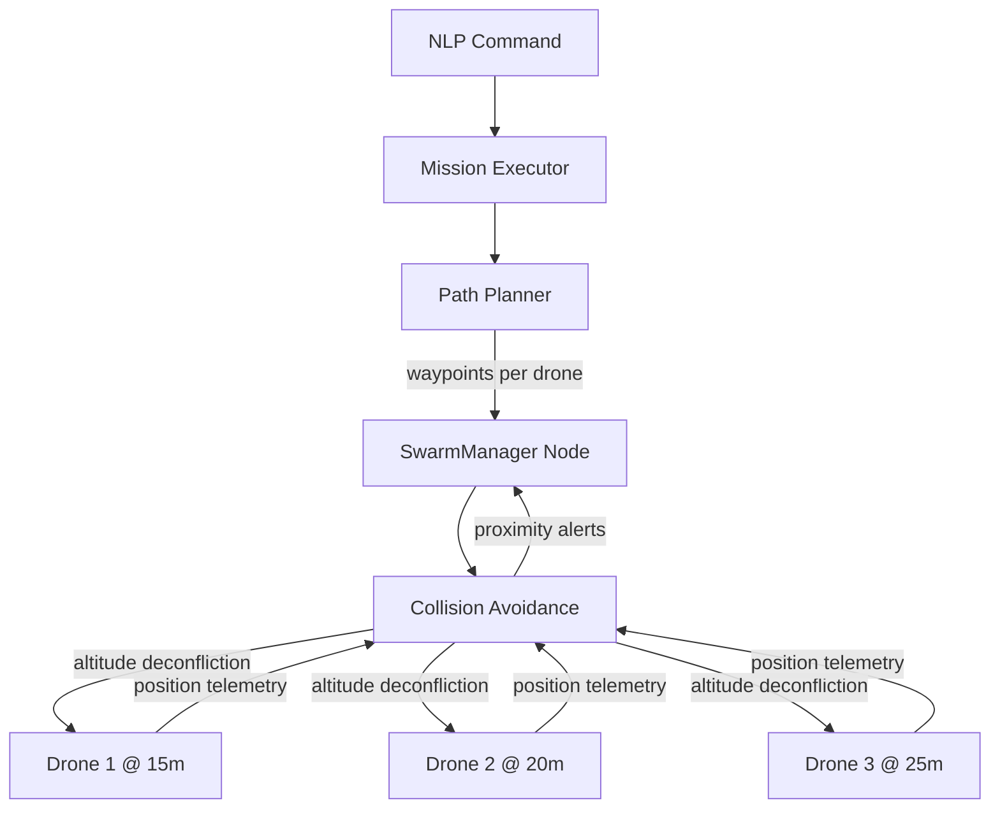

# Collision Avoidance

Three-layer system ensuring drones never collide, even when assigned overlapping objectives like searching the same area.

## Why This Matters

When multiple drones receive commands like "all drones search this field" or "find the person," they converge on the same XY coordinates. Without deconfliction, they crash. The real drone has no onboard obstacle avoidance — all safety comes from the orchestrator.

## Layer 1: Altitude Deconfliction (Static)

Every drone is assigned a unique altitude layer based on its ID:

| Drone ID | Altitude AGL | NED Z |
|----------|-------------|-------|
| 1 | 15m | -15.0 |
| 2 | 20m | -20.0 |
| 3 | 25m | -25.0 |

Formula: `altitude = base (15m) + (drone_id - 1) * layer (5m)`

This is enforced at the SwarmManager level — any waypoint sent to a drone has its Z overridden to that drone's assigned altitude. Even if the NLP layer or path planner outputs the same altitude for all drones, they fly at different heights.

**Config:** `CollisionAvoidanceConfig.altitude_base_m` and `altitude_layer_m` in `config.py`.

## Layer 2: Separation Monitoring (Active)

Every tick (10 Hz), the system computes pairwise 3D distances between all drones:

- **Warning threshold (10m):** Log alert, no action
- **Critical threshold (5m):** Trigger Layer 3 reactive avoidance

With altitude layering, drones at the same XY are always 5m+ apart vertically. The monitoring catches edge cases: rapid altitude changes during takeoff/landing, or manual override scenarios.

## Layer 3: Reactive Avoidance (Emergency)

When two drones breach critical distance:

1. Compute the horizontal separation vector between them
2. Apply a repulsive offset pushing each drone away from the other
3. The offset scales with proximity — closer = stronger push
4. Capped at `max_repulsive_offset_m` (8m) to prevent oscillation

The lower-ID drone gets pushed in the +direction, higher-ID in the -direction. This deterministic tie-breaking prevents both drones dodging the same way.

## Layer 0: Waypoint Pre-Check (Planning)

Before assigning a waypoint to a drone, `is_waypoint_safe()` checks whether any other drone is currently within critical distance of that point. If unsafe, the orchestrator can delay or reroute.

## Architecture

## Configuration

All values in `drone_vla/config.py` under `CollisionAvoidanceConfig`:

| Parameter | Default | Description |
|-----------|---------|-------------|
| `altitude_base_m` | 15.0 | Lowest drone altitude |
| `altitude_layer_m` | 5.0 | Vertical spacing between drones |
| `warning_distance_m` | 10.0 | Log warning threshold |
| `critical_distance_m` | 5.0 | Trigger reactive avoidance |
| `repulsive_gain` | 3.0 | Avoidance force multiplier |
| `max_repulsive_offset_m` | 8.0 | Max avoidance displacement |

## Source Files

- `drone_vla/flight/collision_avoidance.py` — CA logic
- `drone_vla/flight/px4_drone.py` — Per-drone PX4 ROS2 controller
- `drone_vla/flight/swarm_node.py` — Central node (runs CA + telemetry)
- `scripts/test_collision_avoidance.py` — Integration test

## Log Throttling (Added Day 5)

Collision avoidance warnings are throttled to **1 message per 5 seconds per drone pair**. Without throttling, 3 drones on the ground (all within 5m) generated ~30 log messages/second, which:

1. Flooded the WebSocket connection to the browser
2. Caused Chrome to freeze/crash
3. Made the Command Center unusable

The `_log_throttled()` method uses a dictionary keyed by `(drone_a, drone_b, severity)` with `time.monotonic()` timestamps. The avoidance calculations still run at full rate — only the logging is throttled.