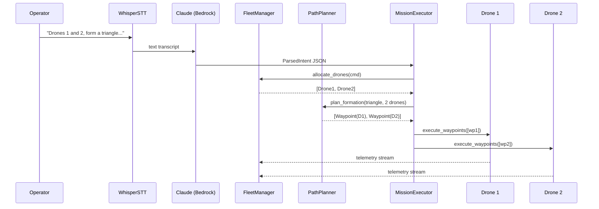

# Data Flow: Voice Command to Drone Movement

This document traces a single operator command through the entire [4-tier pipeline](./system-overview.md).

## Example Command

> "Drones 1 and 2, form a triangle at 20 meters and orbit the central building."

## Step-by-Step Flow



### Step 1: Speech-to-Text

The `WhisperSTT` engine continuously monitors the microphone. When voice activity is detected (RMS > threshold), it records until 1.5s of silence, then transcribes the audio chunk using faster-whisper.

- **Input:** Raw audio (16kHz, float32)
- **Output:** `"Drones 1 and 2, form a triangle at 20 meters and orbit the central building."`
- **Latency:** ~200ms for base.en model on CPU

### Step 2: Intent Extraction

The `IntentParser` sends the transcript to Claude on AWS Bedrock with a system prompt that defines all mission types, drone assignment syntax, and the [MissionCommand schema](../api/mission-schemas.md).

- **Input:** Text + current fleet state summary
- **Output:**
```json
{
  "commands": [{
    "mission_type": "formation_flight",
    "assignment": {"drone_ids": [1, 2]},
    "formation_type": "triangle",
    "altitude_agl_m": 20.0,
    "center_point": null,
    "raw_intent": "Drones 1 and 2, form a triangle at 20 meters..."
  }],
  "confidence": 0.92
}
```
- **Latency:** ~800ms via Bedrock

### Step 3: Fleet Allocation

The `FleetManager` checks that drones 1 and 2 are available and healthy. If either is unavailable, it logs a warning and filters to only available drones.

- **Battery check:** Must be above `min_battery_pct` (default 20%)
- **Status check:** Must be `idle` or `landed`
- **Assigns:** Mission ID (e.g., `M0001`), updates status to `in_mission`

### Step 4: Path Planning

The `PathPlanner.plan_formation()` computes GPS positions for each drone in a triangle formation centered on the specified point (or the centroid of current positions if no center given).

- **Spacing:** 10m default between positions
- **Heading:** Aligned to command heading or 0 degrees
- **Output:** One `Waypoint` per drone

### Step 5: Waypoint Execution

The `MissionExecutor` dispatches waypoints to each drone through the `MAVLinkBridge`. Each `Drone` object calls `goto_location()` via MAVSDK and waits for position convergence within an acceptance radius (default 2m).

### Step 6: Continuous Telemetry

Each drone streams position, heading, and battery data back to the `FleetManager` at ~1Hz. This enables:
- Real-time status in the operator HUD
- Battery threshold alerts triggering automatic RTH
- Failover detection when heartbeats stop

## Failover Scenario

If Drone 1 goes offline mid-mission:

1. `FleetManager` detects missing heartbeat (>5s)
2. `handle_failover(drone_id=1)` is called
3. Drone 1 status set to `ERROR`, mission assignment cleared
4. Next available drone (highest battery) absorbs mission `M0001`
5. `MissionExecutor` re-dispatches remaining waypoints to the backup drone