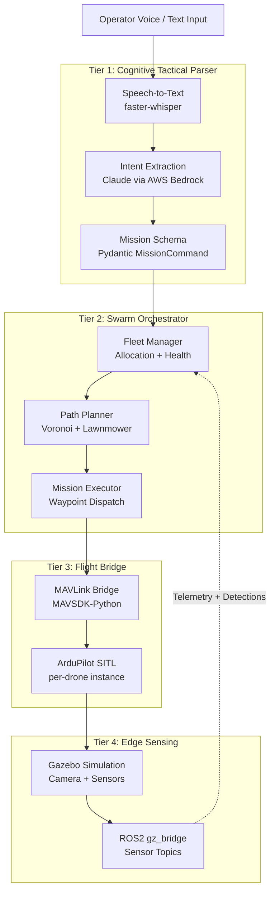

# System Overview

Drone VLA is a 4-tier pipeline that translates natural language operator commands into coordinated multi-drone autonomous missions.

## Architecture Diagram

## Tier Breakdown

### Tier 1: Cognitive Tactical Parser

**Purpose:** Convert spoken or typed natural language into deterministic mission specifications.

| Component | Module | Role |
|-----------|--------|------|
| Speech-to-Text | `stt/whisper_engine.py` | Real-time mic transcription via faster-whisper with VAD |
| Intent Parser | `nlp/intent_parser.py` | Claude on AWS Bedrock extracts structured [MissionCommand](../api/mission-schemas.md) JSON |
| Schemas | `nlp/schemas.py` | Pydantic v2 models defining all mission types and parameters |

**Key design decision:** Claude via AWS Bedrock was chosen over local models for superior structured output reliability. Temperature is set to 0.0 for deterministic parsing.

### Tier 2: Swarm Orchestrator

**Purpose:** Allocate drones to missions, plan collision-free paths, execute with failover.

| Component | Module | Role |
|-----------|--------|------|
| Fleet Manager | `orchestrator/fleet_manager.py` | Tracks drone state, allocates by battery/availability, handles [failover](./data-flow.md) |
| Path Planner | `orchestrator/path_planner.py` | Voronoi decomposition for area search, formations, orbits, patrols |
| Mission Executor | `orchestrator/mission_executor.py` | Dispatches waypoint plans to individual drones |

**Key design decision:** Voronoi spatial decomposition ensures each drone covers a unique cell with minimal overlap. Failover is automatic — if a drone drops, the orchestrator reassigns its sector to the next available drone.

### Tier 3: Flight Bridge

**Purpose:** Abstract hardware communication. All drone control flows through MAVSDK-Python to ArduPilot.

| Component | Module | Role |
|-----------|--------|------|
| Drone | `flight/drone.py` | Per-drone state machine: arm, takeoff, goto, waypoint sequence, RTH, land |
| MAVLink Bridge | `flight/mavlink_bridge.py` | Multi-instance connection manager with concurrent telemetry streaming |

**Key design decision:** ArduPilot over PX4 — ArduPilot has a functional `ros_gz_bridge` for camera/sensor data; PX4 did not at the time of evaluation.

### Tier 4: Edge Sensing (Simulation)

**Purpose:** Gazebo provides simulated cameras and sensors; `ros_gz_bridge` exposes them as ROS2 topics.

| Component | Config | Role |
|-----------|--------|------|
| ArduPilot SITL | `docker-compose.yml` | 3 simulated ArduCopter instances |
| Gazebo | `docker-compose.yml` | Physics + rendering engine |
| ros_gz_bridge | `launch/simulation.launch.py` | Bridges Gazebo sensor topics to ROS2 |

## ROS2 Integration

The standalone pipeline (`main.py`) works without ROS2. When ROS2 is available, three nodes wrap the pipeline:

1. **STT Node** (`ros2_bridge/stt_node.py`) — publishes to `operator/speech_text`
2. **Intent Node** (`ros2_bridge/intent_node.py`) — subscribes to speech, publishes to `operator/mission_command`
3. **Orchestrator Node** (`ros2_bridge/orchestrator_node.py`) — subscribes to commands, drives the fleet

This decoupled design means any component can be replaced independently (e.g., swap Claude for a local LLM by replacing only the intent node).