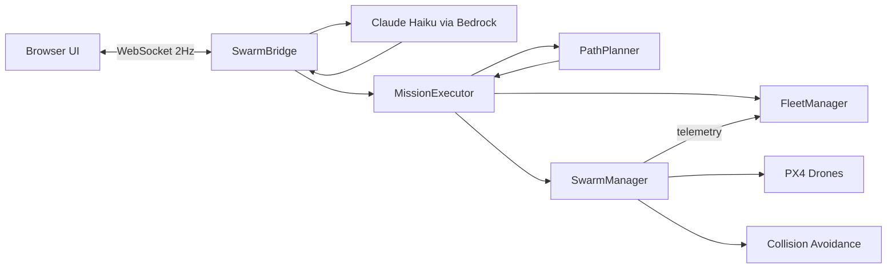

# Command Center

Web-based mission control dashboard for operating the drone swarm.

## Quick Start

```bash
# Simulated mode (no PX4 needed — for UI development)
python3 ~/drone-vla/scripts/start_command_center.py

# Live mode (requires PX4 SITL + MicroXRCE-DDS running)
python3 ~/drone-vla/scripts/start_command_center.py --live
```

Open **http://localhost:8080** in a browser.

### Modes

| Mode | Flag | What happens |
|------|------|--------------|
| Simulated | (default) | Fake telemetry, NLP parses but doesn't execute |
| Live | `--live` | ROS2 SwarmManager connects to PX4, commands execute end-to-end |

Additional flags: `--drones N` (default 3), `--port P` (default 8080).

## Features

### Fleet Status Panel (Left)

Live drone cards showing:
- Drone ID with color coding
- Armed/Flying/Offline status
- Current altitude and assigned CA altitude layer
- NED position and waypoint progress
- Velocity and heading

### Map View (Center)

2D NED coordinate grid showing:
- Drone positions as colored dots
- Heading indicators (direction lines)
- Velocity vectors
- Proximity warning circles when drones are too close
- Click a drone card to highlight it on the map

### Alerts + Event Log (Right)

- **Alerts panel**: Active collision avoidance proximity warnings
- **Event log**: Color-coded scrolling feed
  - Blue (`system`): Server events
  - Green (`operator`): Commands you typed
  - Orange (`nlp`): Intent parser results
  - Red (`ca`): Collision avoidance events
  - Yellow (`drone`): Per-drone events

### Command Input (Bottom)

Two input modes:

1. **Text**: Type a natural language command and press Enter
2. **Voice**: Hold the microphone button to speak (uses browser Web Speech API)

Commands are parsed by Claude Haiku 4.5 via AWS Bedrock into structured `MissionCommand` JSON. The parser extracts mission type, drone assignments, altitude, formation, and parameters.

In **live mode**, parsed commands execute immediately:
- **LAND / RTH / TAKEOFF** → sent directly to SwarmManager
- **Formation, search, patrol, orbit** → routed through MissionExecutor → PathPlanner → SwarmManager GPS waypoints
- FleetManager tracks drone allocation and syncs telemetry from PX4 on every tick

Example commands:
- `send all drones to search the north field at 25 meters`
- `drone 2 orbit the building at 30 meters`
- `drones 1 and 3 fly triangle formation`
- `bring everyone home`

## Architecture



The `SwarmBridge` in `app.py` holds references to all pipeline components. In simulated mode it serves fake telemetry and parses commands without executing. In live mode (`--live`), it wires NLP → MissionExecutor → SwarmManager for full end-to-end command execution.

## API Endpoints

| Endpoint | Method | Description |
|----------|--------|-------------|
| `/` | GET | Dashboard HTML |
| `/ws` | WebSocket | Real-time telemetry + commands |
| `/api/telemetry` | GET | Current drone states |
| `/api/logs` | GET | Recent event log entries |
| `/api/command` | POST | Submit a text command for NLP parsing |

## Source Files

- `drone_vla/web/app.py` — FastAPI backend + WebSocket bridge
- `drone_vla/web/static/index.html` — Single-page dashboard
- `drone_vla/nlp/intent_parser.py` — Claude Bedrock NLP
- `scripts/start_command_center.py` — Launcher script
