# Current System Status

Last updated: 2026-11-20 (Day 3)

## What Works Right Now

### Simulation
- 3-drone PX4 SITL swarm launches with one script
- Drones arm, take off, fly triangle formation, land
- 45-degree camera on drone 1, images bridge to ROS2 at 4-9 Hz
- Collision avoidance enforces altitude layers (D1=15m, D2=20m, D3=25m)

### Command Center
- Web dashboard at `http://localhost:8080`
- Shows 3 drone cards with live (simulated) telemetry
- 2D map with drone positions, headings, velocity vectors
- NLP command input: type a sentence, Claude parses it into structured commands
- Voice input via browser Web Speech API
- Event log with color-coded sources

### NLP Pipeline
- Claude Haiku 4.5 on AWS Bedrock
- Parses: area search, formation, orbit, patrol, RTH, takeoff, land
- Handles multi-command utterances ("drones 1+2 formation, drone 3 orbit")
- Asks for clarification when commands are ambiguous

## What's Scaffolded but Not Connected

| Component | Has Code | Wired to PX4 | Wired to Command Center |
|-----------|----------|-------------|------------------------|
| `SwarmManager` (ROS2 node) | Yes | Not tested live | No — serves simulated data |
| `FleetManager` (allocation) | Yes | No telemetry feed | No |
| `MissionExecutor` (plans → waypoints) | Yes | No flight commands | No |
| `PathPlanner` (Voronoi, formations) | Yes | No | No |
| `IntentParser` (NLP) | Yes | No | Yes (parses, doesn't execute) |
| GPS waypoint navigation | Yes | Not tested live | No |

## What Doesn't Exist Yet

- End-to-end: command → NLP → allocate → plan → fly
- Camera feed in command center
- Whisper STT backend
- Geofencing
- Emergency stop
- Battery enforcement
- Object detection
- Multi-mission concurrency
- Physical drone support

## Architecture Diagram (Current State)

```mermaid
flowchart TD
    subgraph Working
        UI[Command Center UI] <-->|WebSocket| API[FastAPI Backend]
        API --> NLP[Claude Haiku via Bedrock]
        PX4[PX4 SITL x3] --> DDS[MicroXRCE-DDS]
        DDS --> ROS2[ROS2 Topics]
        GZ[Gazebo Camera] --> Bridge[ros_gz_image] --> ROS2
    end

    subgraph NotConnected[Not Connected Yet]
        NLP -.->|parsed commands| Exec[Mission Executor]
        Exec -.-> Fleet[Fleet Manager]
        Fleet -.-> Swarm[SwarmManager Node]
        Swarm -.-> CA[Collision Avoidance]
        CA -.-> PX4Drone[PX4Drone Controllers]
        PX4Drone -.-> ROS2
        ROS2 -.->|telemetry| API
    end

    style Working fill:#1a2744
    style NotConnected fill:#2a1a1a
```



## Launch Commands

```bash
# Start PX4 swarm (terminal 1)
bash ~/drone-vla/scripts/start_px4_swarm.sh

# Start Command Center (terminal 2)
python3 ~/drone-vla/scripts/start_command_center.py

# Test collision avoidance (requires PX4 running)
python3 ~/drone-vla/scripts/test_collision_avoidance.py

# Test camera bridge (requires PX4 with camera running)
python3 ~/drone-vla/scripts/test_camera_bridge.py /world/default/model/x500_mono_cam_45_1/link/camera_link/sensor/imager/image
```
