# Current System Status

Last updated: 2026-11-25 (Day 5, SAR village + CV pipeline)

## Recent Changes

### Day 5 (2026-11-25)
- **SAR village Gazebo world**: Custom world with buildings, vehicles, containers, trees, SAR targets, landing pad — all SDF primitives (no Fuel downloads)
- **Per-drone commands**: `command_land()` accepts optional `drone_ids` — "drone 1 land" only lands drone 1
- **NLP conversation context**: 10-message history window so follow-up commands carry context
- **NLP SAR awareness**: System prompt includes village layout with GPS coords — generates real waypoints instead of asking for coordinates
- **PX4_GZ_WORLD fix**: Standalone PX4 instances (drones 2/3) now get world name passed — were defaulting to "default" and failing
- **CA log throttle**: Collision avoidance messages throttled to 1/5s per drone pair (was flooding WebSocket, freezing browser)
- **Path planner rewrite**: Replaced Voronoi + arc sweeps with clean boustrophedon lawnmower pattern. Lane width in meters (15m default). Multi-drone splits polygon into horizontal strips
- **Next**: YOLO real-time detection + Claude Vision scene analysis, AWS GPU for sim performance

### Day 3-4
- **Camera feed optimized**: 1-camera config (drone 1 = camera, drones 2-3 = lightweight x500)
- Frames downscaled 1280x960 → 480x360, JPEG quality 50, throttled to 4fps
- PX4 stdout redirected to /dev/null, cleanup script + bash aliases added
- Build-in-public content log started (demos/build-in-public-log.md)
- End-to-end command pipeline wired: NLP → FleetManager → MissionExecutor → SwarmManager
- Flattened `src/drone_vla/` → `drone_vla/` at project root

## What Works Right Now

### Simulation
- 3-drone PX4 SITL swarm launches with one script
- Drones arm, take off, fly triangle formation, land
- 45-degree camera on drone 1 only (drones 2-3 use lightweight x500 for performance)
- Camera frames: 480x360 JPEG @ quality 50, throttled to 4fps max
- Collision avoidance enforces altitude layers (D1=15m, D2=20m, D3=25m)

### Command Center
- Web dashboard at `http://localhost:8080`
- Two modes: `--live` (PX4 connected, commands execute) or simulated (UI dev)
- Shows 3 drone cards with live telemetry from PX4
- 2D map with drone positions, headings, velocity vectors
- **Camera feed overlay**: live MJPEG stream from drone cameras, switchable per drone, resizable
- NLP command input: type a sentence, Claude parses and executes it
- Voice input via browser Web Speech API
- Event log with color-coded sources

### End-to-End Pipeline (verified working)
- Type a command → Claude Haiku 4.5 parses intent → FleetManager allocates drones → PathPlanner computes waypoints → SwarmManager sends to PX4 → drones fly in Gazebo
- Tested: "fly triangle formation" → all 3 drones moved to formation positions
- Tested: "land all drones" → all 3 drones descended and landed
- LAND/RTH/TAKEOFF go directly to SwarmManager; complex missions route through MissionExecutor

### NLP Pipeline
- Claude Haiku 4.5 on AWS Bedrock
- Parses: area search, formation, orbit, patrol, RTH, takeoff, land
- Handles multi-command utterances ("drones 1+2 formation, drone 3 orbit")
- Asks for clarification when commands are ambiguous

## What's Wired (via `--live` mode)

| Component | Has Code | Wired to PX4 | Wired to Command Center |
|-----------|----------|-------------|------------------------|
| `SwarmManager` (ROS2 node) | Yes | Yes (--live) | Yes (telemetry + commands) |
| `FleetManager` (allocation) | Yes | Yes (telemetry sync) | Yes (via MissionExecutor) |
| `MissionExecutor` (plans → waypoints) | Yes | Yes (via SwarmManager) | Yes |
| `PathPlanner` (Voronoi, formations) | Yes | Yes (via MissionExecutor) | Yes |
| `IntentParser` (NLP) | Yes | Yes (parses + executes in live) | Yes |
| GPS waypoint navigation | Yes | Yes (via SwarmManager) | Yes |

## What Doesn't Exist Yet

- Whisper STT backend
- Geofencing
- Emergency stop
- Battery enforcement
- Object detection
- Multi-mission concurrency
- Physical drone support

## Architecture Diagram (Current State)

```mermaid
flowchart TD
    subgraph Pipeline["End-to-End Pipeline (--live mode)"]
        UI[Command Center UI] <-->|WebSocket 2Hz| Bridge[SwarmBridge]
        Bridge --> NLP[Claude Haiku via Bedrock]
        NLP -->|ParsedIntent| Bridge
        Bridge -->|LAND/RTH/TAKEOFF| Swarm[SwarmManager]
        Bridge -->|complex missions| Exec[MissionExecutor]
        Exec --> Fleet[FleetManager]
        Exec --> PP[PathPlanner]
        PP -->|Waypoints| Exec
        Exec -->|GPS waypoints| Swarm
        Swarm --> CA[Collision Avoidance]
        CA --> PX4Drone[PX4Drone x3]
        PX4Drone --> ROS2[ROS2 / MicroXRCE-DDS]
        ROS2 --> PX4[PX4 SITL]
        Swarm -->|telemetry| Fleet
        GZ[Gazebo Camera] --> ImgBridge[ros_gz_image] --> ROS2
    end

    style Pipeline fill:#1a2744
```



## Launch Commands

```bash
# Start PX4 swarm (terminal 1)
bash ~/drone-vla/scripts/start_px4_swarm.sh

# Start Command Center (terminal 2)
python3 ~/drone-vla/scripts/start_command_center.py

# Test collision avoidance (requires PX4 running)
python3 ~/drone-vla/scripts/test_collision_avoidance.py

# Test camera bridge (requires PX4 with camera running)
python3 ~/drone-vla/scripts/test_camera_bridge.py /world/default/model/x500_mono_cam_45_1/link/camera_link/sensor/imager/image
```
