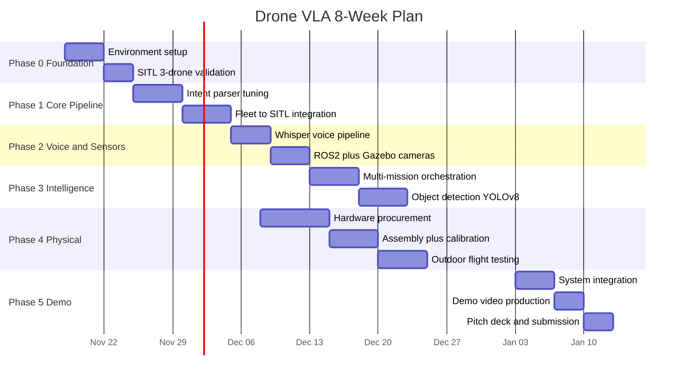

# Master Project Plan

> **Goal:** One operator speaks into a mic. Three physical drones take off, form a triangle, sweep a search area, and return — all autonomously. Captured on video for demo day.

## Constraints

| Parameter | Value |
|-----------|-------|
| Time budget | ~4 hours/day (half-time) |
| Total duration | **8 weeks** (Nov 18, 2026 — Jan 12, 2027) |
| AWS credits | $20,000 (Bedrock, EC2, etc.) |
| Drone budget | TBD — see [Hardware Recommendations](./hardware-recommendations.md) |
| Target | Demo day / pitch event with live video |

## Phase Overview

## Phase 0: Foundation (Nov 18-24) — Week 1

**Goal:** ArduPilot SITL + Gazebo running, 3 drones taking off and moving via Python.

This is the unsexy but critical infrastructure week. If the simulation environment does not work, nothing else matters.

| Day | Hours | Task | Done When |
|-----|-------|------|-----------|
| Mon 11/18 | 4h | Install ArduPilot SITL (Docker or WSL2). Get single instance booting. | `sim_vehicle.py` runs without error |
| Tue 11/19 | 4h | Multi-instance SITL: 3 ArduCopters on separate ports. Install Gazebo. | 3 drones visible in Gazebo |
| Wed 11/20 | 4h | MAVSDK-Python: connect to all 3 SITL instances. Arm + takeoff script. | Python script arms and takes off 3 drones |
| Thu 11/21 | 4h | Waypoint navigation: send goto commands, verify position convergence. | Drones fly to commanded GPS positions |
| Fri 11/22 | 4h | Telemetry streaming: position, battery, heading at 1Hz per drone. | Terminal showing live telemetry from 3 drones |
| Sat 11/23 | 2h | **CHECKPOINT 1:** record screen showing 3 drones flying in Gazebo via Python. | Screen recording shared |
| Sun 11/24 | — | Rest / catch-up buffer | — |

Detailed breakdown: [Week 1: Foundation](./week-1-foundation.md)

---

## Phase 1: Core Pipeline (Nov 25 - Dec 4) — Weeks 2-3

**Goal:** Type a natural language command, drones execute it in simulation.

| Day | Hours | Task | Done When |
|-----|-------|------|-----------|
| Mon 11/25 | 4h | Test intent parser standalone: 20 sample commands, validate JSON output | 18/20 produce valid MissionCommand JSON |
| Tue 11/26 | 4h | Prompt engineering: edge cases, multi-command utterances, ambiguity | Parser handles compound commands |
| Wed 11/27 | 4h | Connect fleet manager to live SITL telemetry. Real battery data. | Fleet manager shows live status |
| Thu 11/28 | 4h | Wire parser, fleet manager, executor, MAVLink bridge end-to-end | Typed command produces drone movement |
| Fri 11/29 | 4h | Test all mission types: takeoff, formation, area search, orbit, RTH | Each type executes correctly |
| Sat 11/30 | 2h | **CHECKPOINT 2:** record typed command to drone movement video | Video shared |
| Mon 12/1 | 4h | Failover: kill SITL instance mid-mission, verify backup takes over | Drone dies, another absorbs sector |
| Tue 12/2 | 4h | Path planner tuning: Voronoi quality, formation spacing, orbit smoothness | Visually clean paths in Gazebo |
| Wed 12/3 | 4h | Battery monitor + auto-RTH: drain battery, verify automatic return | Low battery triggers auto-return |
| Thu 12/4 | 2h | Integration testing + bug fixes. Buffer. | All text commands work reliably |

Detailed breakdown: [Weeks 2-3: Core Pipeline](./week-2-3-core-pipeline.md)

---

## Phase 2: Voice and Sensors (Dec 5-12) — Week 4

**Goal:** Full voice-to-flight pipeline. Camera feeds from Gazebo into ROS2.

| Day | Hours | Task | Done When |
|-----|-------|------|-----------|
| Fri 12/5 | 4h | Whisper STT: test with mic, tune VAD thresholds, measure latency | Speech to text within 300ms |
| Sat 12/6 | 2h | Voice to intent to flight: speak a command, watch drones move | Voice pipeline works end-to-end |
| Mon 12/8 | 4h | **CHECKPOINT 3:** record voice command to drone movement with audio | Video shared |
| Tue 12/9 | 4h | ros_gz_bridge: camera topics from Gazebo into ROS2 | Image data on ROS2 camera topic |
| Wed 12/10 | 4h | ROS2 node integration: all 3 nodes running as a graph | `ros2 node list` shows all nodes |
| Thu 12/11 | 4h | Operator HUD: terminal dashboard with fleet status and mission progress | Live terminal UI updating |
| Fri 12/12 | 2h | Polish + buffer | — |

---

## Phase 3: Intelligence (Dec 13-23) — Weeks 5-6

**Goal:** Multi-mission orchestration, object detection, dynamic replanning.

| Day | Hours | Task | Done When |
|-----|-------|------|-----------|
| Mon 12/13 | 4h | Concurrent missions: 2 missions with deconfliction | 2 swarms operate simultaneously |
| Tue 12/14 | 4h | Dynamic replanning: mid-mission voice override | Override interrupts and redirects |
| Wed 12/15 | 4h | Context memory: LLM remembers fleet state across commands | Cross-reference commands work |
| Thu 12/16 | 4h | YOLOv8 on AWS EC2 GPU: thermal person detection model | Detects objects in Gazebo camera |
| Fri 12/17 | 4h | Detection to notification: geo-tagged alert to operator | Alert with GPS and confidence |
| Mon 12/19 | 4h | Detection-triggered behavior: auto-orbit detected target | Drone orbits detected person |
| Tue 12/20 | 4h | Stress test: 30-min session with full feature set | Unbroken 30-min session |
| Wed 12/21 | 2h | **CHECKPOINT 4:** uncut video of full sim demo | Video shared |
| Thu 12/22 | 4h | Bug fixes, edge cases, reliability hardening | — |
| Fri 12/23 | 2h | **Simulation code freeze.** Document all APIs. | All docs current |

---

## Phase 4: Physical Drones (Dec 8 - Jan 2) — Overlapping

**Goal:** 3 physical ArduPilot drones assembled, calibrated, flying voice missions.

Hardware ordering starts during Phase 2 so shipping time is absorbed.

| Day | Hours | Task | Done When |
|-----|-------|------|-----------|
| Dec 8 | 1h | Order hardware — see [Hardware Recommendations](./hardware-recommendations.md) | Order confirmed |
| Dec 15-17 | — | Hardware arrives | Boxes on desk |
| Dec 18 | 4h | Assembly: drone 1 — frame, motors, ESC, FC, GPS | 1 drone assembled |
| Dec 19 | 4h | Assembly: drones 2 and 3 | All 3 assembled |
| Dec 20 | 4h | Firmware: ArduPilot on all 3 Pixhawks. Calibrate accel, compass, ESC. | All pass preflight |
| Dec 22 | 4h | First flights: manual mode, hover test, GPS hold | 3 drones hover stably |
| Dec 23 | 4h | MAVLink telemetry: laptop to 3 drones over Wi-Fi / telemetry radio | Python reads all 3 |
| Dec 26 | 4h | MAVSDK commands: arm, takeoff, goto from laptop | Physical drones respond |
| Dec 28 | 4h | Multi-drone coordination: triangle formation at 10m spacing | 3 drones hold triangle |
| Dec 30 | 4h | Voice-to-physical: full NLP pipeline to physical drones | Voice moves real drones |
| Jan 2 | 4h | Outdoor stress test + safety procedures | 10+ commands no failure |

---

## Phase 5: Demo and Polish (Jan 3-12) — Week 8

**Goal:** Production-quality demo video + pitch materials.

| Day | Hours | Task | Done When |
|-----|-------|------|-----------|
| Sat 1/3 | 4h | System integration: sim + physical unified, config switch | Same code runs both |
| Sun 1/4 | 4h | Reliability: 20 consecutive voice commands without failure | 20/20 success rate |
| Mon 1/5 | 4h | Demo choreography: script exact sequence for video | Written shot list |
| Tue 1/6 | 4h | Film attempt 1: outdoor, 3 drones + voice + screen capture | Raw footage captured |
| Wed 1/7 | 4h | Film attempt 2 + edit video | 45-second demo cut |
| Thu 1/8 | 4h | **CHECKPOINT 5:** demo video done | Video uploaded |
| Fri 1/9 | 4h | Pitch deck: problem, solution, demo, market, team, ask | Deck reviewed |
| Sat 1/10 | 4h | Submit application + post on X/LinkedIn | Submitted |
| Sun 1/11 | 2h | Final docs: journey retrospective, lessons learned | Journey doc complete |
| Mon 1/12 | — | **Project complete.** | Celebrate. |

---

## Accountability Framework

### 5 Hard Checkpoints

Share with your accountability partner. Binary pass/fail — recording or it did not happen.

| # | Date | Checkpoint | Evidence |
|---|------|-----------|----------|
| 1 | **Nov 23** | 3 drones fly in Gazebo via Python | Screen recording |
| 2 | **Nov 30** | Typed NL command moves drones in sim | Screen recording |
| 3 | **Dec 8** | Voice command moves drones in sim | Video with audio |
| 4 | **Dec 21** | Full sim demo: formation + search + detection + failover | Uncut video |
| 5 | **Jan 8** | Physical 3-drone demo video | 45-second pitch video |

### Daily Practice

- **Start of session:** Open the [Daily Log](./daily-log.md), write what you plan to do
- **End of session:** Write what you actually did, what blocked you, what is next
- **Weekly:** Review the week, update milestone status, share with accountability partner

### If You Fall Behind

- **1-2 days behind:** Use weekend buffer days. Do not skip phases.
- **1 week behind:** Cut Phase 3 scope. Drop YOLOv8 detection, keep multi-mission. The demo video matters more than every feature.
- **2+ weeks behind:** Go physical-first. Skip advanced sim features, get hardware flying with basic voice commands. A real drone responding to voice beats a perfect simulation every time.

---

## Budget Estimate

See [Hardware Recommendations](./hardware-recommendations.md) for the full breakdown.

| Category | Estimate |
|----------|----------|
| AWS Bedrock (Claude calls) | ~$50-100 of $20K credits |
| AWS EC2 (GPU for YOLOv8) | ~$100-200 of credits |
| 3x Drone hardware | $900-2,100 (see hardware doc) |
| Telemetry radios / Wi-Fi | $50-150 |
| Misc (props, batteries, tools) | $100-200 |
| **Total out-of-pocket** | **$1,050-2,450** (AWS covered by credits) |